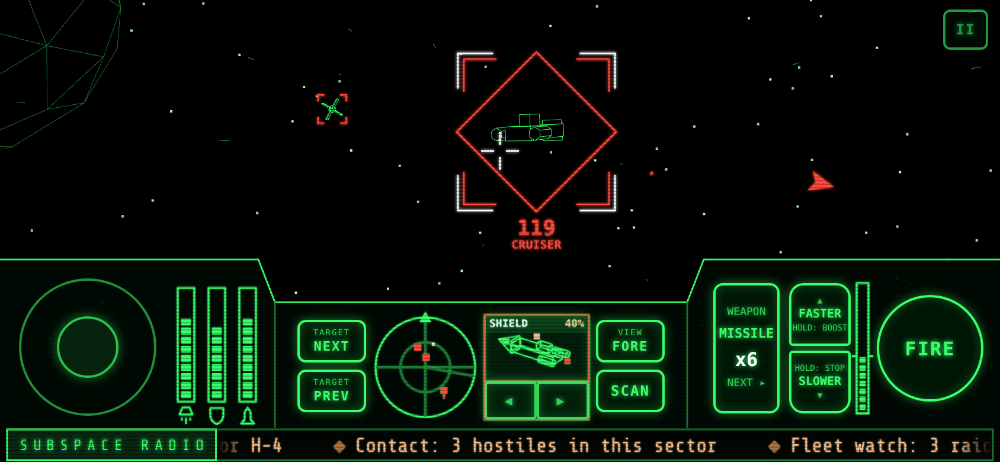

# Starguard

A first-person space shooter in an 80s vector-arcade style, built as a prototype to find the fun. You fly one ship from a cockpit, fight raider fleets, and use a sector map to decide where to fight. It targets an iPhone-size screen in landscape with touch controls, and also runs in a desktop browser.

**Play:** https://thoracle.github.io/starguard/



## The game

- Raider fleets cross an 8 by 6 sector grid toward three stations. Lose HOME CONTROL, or your ship, and the run is over. There is no win state: the aim is score and waves survived. Your score is shown when the run ends; it is not saved.
- SCAN opens the nav computer. Tap a sector and WARP there. Jumps cost energy and time, and the fight in your sector keeps running while you read the chart.
- Lasers, homing missiles and aft-only torpedoes. Tap a ship to target it, then pick its weapon, shield or engine to concentrate your hits.
- Fly into a station ring to refuel, repair and rearm.
- Stations and the raider leader hail you over a comms channel with talking heads.

## Controls

| Touch | Keyboard | Action |
|---|---|---|
| Left thumb, anywhere on the left side | WASD or arrows | Steer |
| FIRE | Space | Fire the selected weapon |
| WEAPON | Q | Cycle laser, missile, torpedo |
| FASTER / SLOWER (tap) | `=` / `-` | Step the throttle |
| FASTER (hold) | Shift | Boost |
| SLOWER (hold) | X | Full stop |
| VIEW | V | Fore or aft view |
| Tap a ship, or TARGET NEXT / PREV | T / Shift+T | Choose a target |
| Scope arrows | `[` / `]` | Choose a subsystem |
| SCAN, then WARP | M, then Enter | Nav computer and warp |
| Pause (top right) | P or Esc | Pause and settings |

## Run it locally

Needs Python 3. No Node.js and no build step.

```sh
python3 -m venv .venv
.venv/bin/pip install -r requirements.txt
.venv/bin/python app.py          # http://localhost:5000
```

`HOST` and `PORT` environment variables change the address. The page loads three.js and one typeface from public CDNs, so the browser needs internet access.

## What is in here

| Path | What it is |
|---|---|
| `index.html` | The whole game: markup, styles and one JavaScript module using three.js. All tuning values sit in the `T` block at the top of the script. |
| `app.py` | Optional Flask app that serves the page for local and test-box use. Opening it through any static web server works too. |
| `deploy/` | systemd unit (gunicorn on port 5079), the nginx block that mounts it at `/starguard/`, and `publish.sh`, which installs both. |
| `docs/requirements/` | The requirements document: numbered requirements plus annotated screenshots of the cockpit, targeting, comms and nav computer. Open `index.html` in a browser. |
| `tools/tests/` | Browser smoke scripts (Playwright). Each drives the running game and prints what it found for a person to read; they do not assert pass or fail. |
| `tools/docs/` | Builds the requirements document: `build.sh` re-shoots the figures and reassembles the page. The requirement text lives in `mkreq.py`. |

## Deployment

The game is a single static page, so it is published with GitHub Pages straight from the `master` branch: pushing to `master` updates https://thoracle.github.io/starguard/.

`deploy/` is for our own test box, which serves the working folder through a small Flask app so edits show up as soon as they are saved. `sh deploy/publish.sh` installs that service and its nginx block; it is safe to re-run.

## Tests and tools

```sh
.venv/bin/pip install -r tools/requirements.txt && .venv/bin/playwright install chromium
.venv/bin/python tools/tests/targeting.py        # any script in tools/tests/
sh tools/docs/build.sh                           # rebuild docs/requirements/
```

The scripts talk to the game at `STARGUARD_URL` (default `http://127.0.0.1:5079/`) and write screenshots to `tools/out/`.

## Hat tip

Starguard is an original game, but it stands on two classics and owes them its shape:

- **Star Raiders** (Atari, designed by Doug Neubauer for the Atari 8-bit computers), which established the form: a first-person cockpit, a galactic chart, hyperwarp between sectors, starbases to defend and dock at, and ship systems that can be knocked out.
- **Star Luster** (Namco, 1985, Famicom), which carried that form forward and was the direct starting point for this prototype: the cockpit with radar, energy and shield readouts.

The wireframe look is a nod to the vector arcade games of the same era, Atari's Battlezone in particular. No code, art, names or audio from any of these games is used here.

## Status

A prototype. It has been tested in a headless desktop browser at phone sizes; touch feel, frame rate and audio on real iPhone and iPad hardware are not yet confirmed. Balance is untuned, and the open questions are listed at the end of the requirements document.

## Licence

MIT. See [LICENSE](LICENSE).
